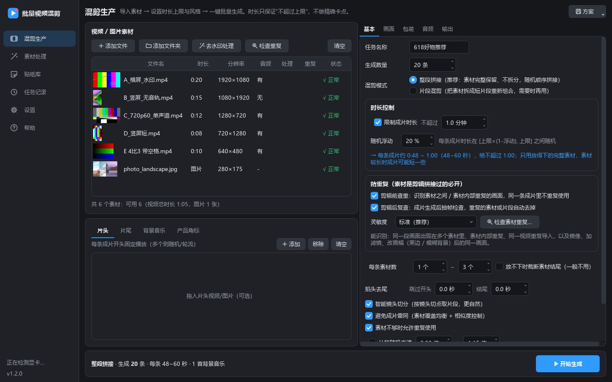
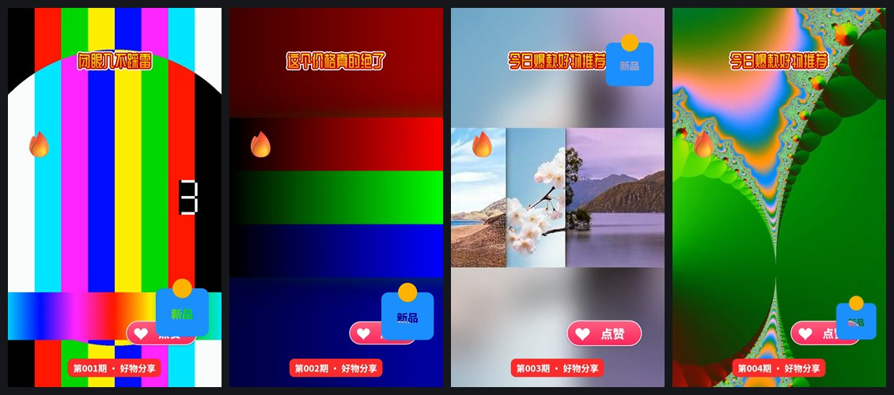

<p align="center">
  
</p>

<h1 align="center">批量视频混剪工具</h1>

<p align="center">
  批量导入素材 · 时长上限控制 · 素材查重防重复 · 去水印/去贴纸/去遮挡 · 滤镜贴纸花字 · 一键批量成片
</p>

<p align="center">
  <a href="https://github.com/lxk7-ui/BatchVideoMixer/releases/latest"></a>
  
  
  
  <a href="LICENSE"></a>
</p>

把一批**自有或已授权**的视频、图片素材，按设定规则自动组合、统一画面规格、加上标题贴纸和背景音乐，**一次批量产出几十上百条互不相同的成片**。
Windows 桌面程序，内置 FFmpeg、字体和贴纸库，不需要安装任何运行库，完全离线运行。



## 功能

- **时长上限控制**：每条成片“不超过 X 分钟”，可设随机浮动（例如 1 分钟、浮动 20% → 每条 48～60 秒）。只限上限、不做精确卡点；按帧规划 + 合成兜底截断，绝不超时。
- **防重复**：素材本身是剪辑拼接的也不怕。剪辑前查重能认出转码、调色、加字幕、镜像、加黑边、横屏改竖屏后的同一画面，同一条成片不重复使用；剪辑后抽帧复查，并对照素材原始画面确认，真重复才剪掉。
- **整段拼接（默认）**：素材从第一帧到最后一帧完整保留、不拆分，随机顺序拼接；转场用定格过渡，不占用素材画面。需要时也可以用**片段混剪**（拆成短片段重新组合，可对齐镜头切点）。
- **音画同步**：素材里声音比画面晚开始、声音中途断档都会自动补齐，声音、字幕和画面严格对齐。
- **去水印 / 去贴纸 / 去遮挡**：框选或画笔涂抹，智能填充、模糊、马赛克、色块覆盖；自动识别固定水印；按时间段处理换位置的水印；裁边、自动检测黑边。
- **包装**：33 款滤镜 + 10 项调节、289 款贴纸（原创 + Fluent 3D 表情，可导入 GIF/WebP 动图）、16 种花字、5 款可商用字体、入场/循环/出场动画、23 种叠化转场 + 5 种切换特效。
- **音频**：原声保留/压低/去除，背景音乐随机选曲和起点、自动循环，EBU R128 响度统一，结尾淡出。
- **画面适配**：竖屏/横屏/方形多种规格；比例不一致时模糊背景填充、黑边或裁剪；自动处理手机旋转视频、HDR、可变帧率、奇数分辨率。
- **效率与稳定**：显卡编码（NVIDIA / Intel / AMD，实测可用才启用、失败自动回退 CPU）、多路并行、断点续跑、失败自动重试、无进度看门狗、防休眠。
- **生成时电脑不卡**：三档负载，默认“流畅优先”——全部生成任务合计最多用约 60% 的 CPU（Windows 作业对象硬上限），并调低进程、内存和磁盘读写优先级。
- **可追溯**：每个任务保存参数、计划、查重结果、日志和 CSV 报告，自动挑选封面。



## 下载

到 [Releases](https://github.com/lxk7-ui/BatchVideoMixer/releases/latest) 下载：

| 文件 | 说明 |
|---|---|
| `BatchVideoMixer-Setup-v1.2.0.exe` | **安装版（推荐）**：不需要管理员权限，桌面和开始菜单有快捷方式，可正常卸载 |
| `BatchVideoMixer-Portable-v1.2.0.exe` | **免安装版**：单个 exe，双击即用；第一次启动解压约 20 秒，之后 3～5 秒 |
| `BatchVideoMixer-Manual-v1.2.0.docx` / `BatchVideoMixer-QuickStart-v1.2.0.docx` | 使用文档 / 上手文档（Word 版） |

**系统要求**：Windows 10（1809 及以上）/ Windows 11，64 位。已针对 Windows 10 IoT 企业版 LTSC 21H2 做兼容设计。

> [!NOTE]
> 程序没有代码签名，第一次运行时 Windows 可能提示“已保护你的电脑”，点 **更多信息 → 仍要运行**。部署到新电脑后建议先在“设置 → 环境自检”里跑一次。

## 快速上手

1. 把视频、图片（或整个文件夹）拖进素材列表；
2. “时长控制”填 **不超过 X 分钟** 和随机浮动；
3. “防重复”保持勾选（素材是剪辑拼接的一定要开）；
4. 填生成数量，点 **开始生成**；
5. 完成后点“打开输出文件夹”，成片在“成片”子文件夹。

详细说明见 [上手文档](docs/上手文档.md)（10 分钟上手，带标注截图）和 [使用文档](docs/使用文档.md)（全部功能与参数）。

## 文档

| 文档 | 内容 |
|---|---|
| [上手文档](docs/上手文档.md) | 第一次使用：安装、5 步出第一批成片、防重复、去水印、包装、常见问题 |
| [使用文档](docs/使用文档.md) | 全部功能、参数、输出文件、性能建议、常见问题 |
| [开发说明](docs/开发说明.md) | 搭环境、运行、打包、文档生成、测试、关键设计 |
| [更新记录](CHANGELOG.md) | 各版本变化 |

## 从源码运行

需要 Windows 10/11 x64、Python 3.12、FFmpeg 8.x（gpl-shared 版）。

```bat
git clone https://github.com/lxk7-ui/BatchVideoMixer.git
cd BatchVideoMixer
py -3.12 -m venv _deps\venv
_deps\venv\Scripts\python.exe -m pip install -r requirements.txt
```

下载 [BtbN/FFmpeg-Builds](https://github.com/BtbN/FFmpeg-Builds/releases) 的 `ffmpeg-n8.1-latest-win64-gpl-shared-8.1.zip`，把 `bin\` 下的全部文件和 `LICENSE.txt` 放到 `_deps\ffmpeg\`，然后：

```bat
_deps\venv\Scripts\python.exe src\main.py
```

打包安装版和免安装版（还需要 Inno Setup 6）：

```bat
_deps\venv\Scripts\python.exe tools\build.py --package
```

测试、文档生成等见 [开发说明](docs/开发说明.md)。

## 项目结构

```
src/            程序源码：mixer/（引擎：规划、查重、渲染、批量调度）、ui/（PySide6 界面）、assets/（字体、贴纸、图标）
tests/          冒烟测试、界面联调、文档截图脚本、测试素材生成
tools/          打包（PyInstaller + Inno Setup + 单文件启动器）、HTML / Word 文档生成、贴纸生成
docs/           使用文档、上手文档、开发说明（Markdown）及截图
```

## 第三方组件

| 组件 | 协议 | 用途 |
|---|---|---|
| [FFmpeg](https://ffmpeg.org) 8.1（BtbN gpl-shared 构建） | GPL v3 | 音视频处理。以独立程序随安装包分发，协议见程序目录 `ffmpeg\LICENSE.txt`，源码见 ffmpeg.org |
| [Qt 6 / PySide6](https://www.qt.io) | LGPL v3 | 界面，以动态库形式随附 |
| Python、NumPy、Pillow | PSF / BSD / HPND | 运行环境与图像处理 |
| [Microsoft Fluent Emoji](https://github.com/microsoft/fluentui-emoji) | MIT | 3D 表情贴纸，见 [src/assets/stickers](src/assets/stickers/README.md) |
| 思源黑体、得意黑、站酷快乐体、站酷庆科黄油体、马善政毛笔楷书 | SIL OFL 1.1 | 花字字体，见 [src/assets/fonts](src/assets/fonts/README.md) |
| [Inno Setup](https://jrsoftware.org/isinfo.php) | Inno Setup License | 制作安装包 |

电商标签、互动引导、箭头、装饰、对话气泡贴纸，以及滤镜参数、花字预设为本项目原创。

## 使用规范

本工具用于对**自有或已获授权**的素材进行批量整合、规格统一、模板化剪辑和多版本生产。

- 请只处理你有权使用的素材，尊重著作权与各平台规则。
- 去水印 / 去贴纸功能用于清理自有素材上的旧水印、误加贴纸或遮挡物，**请勿用于去除他人作品的署名水印或搬运他人作品**。
- “画面变体”“防重复”是多版本测试和成片质量功能，**不承诺、也不应被用于“过审 / 去重 / 伪原创”**。
- 剪映（CapCut）贴纸素材版权属于字节跳动及原作者，本项目未抓取、未内置。

## 许可

本项目源码以 [MIT License](LICENSE) 发布。随附的第三方组件（FFmpeg、Qt、字体、Fluent Emoji 等）遵循各自的协议。
