# 批量视频混剪工具 · 上手文档

10 分钟学会批量出片（v1.1.0）。截图里的红色编号①②③④与正文步骤一一对应。完整的参数说明见[使用文档](使用文档.md)。

## 目录

1. [一分钟了解](#1-一分钟了解)
2. [安装与第一次打开](#2-安装与第一次打开)
3. [第一批成片：5 步搞定](#3-第一批成片5-步搞定)
4. [素材是拼接过的？防重复这样用](#4-素材是拼接过的防重复这样用)
5. [去水印 / 去贴纸 / 去遮挡](#5-去水印--去贴纸--去遮挡)
6. [给成片加包装：标题、贴纸、Logo](#6-给成片加包装标题贴纸logo)
7. [贴纸库与自己的贴纸](#7-贴纸库与自己的贴纸)
8. [停了、断电了怎么办](#8-停了断电了怎么办)
9. [推荐设置速查](#9-推荐设置速查)
10. [常见问题](#10-常见问题)
11. [使用须知](#11-使用须知)

## 1. 一分钟了解

批量视频混剪工具把一批**自有或已授权**的视频、图片素材，按你设定的规则自动组合、统一画面规格、加上标题贴纸和背景音乐，**一次批量产出几十上百条互不相同的成片**。全程离线运行，不需要联网。

| 你想要…… | 用这个功能 | 在哪里 |
|---|---|---|
| 每条成片**不超过 X 分钟** | 时长控制（只限上限，不做精确卡点） | 混剪生产 → 基本 |
| 素材是剪辑拼接过的，成片里**不要出现重复画面** | 防重复（默认开启） | 混剪生产 → 基本 → 防重复 |
| 去掉素材上的**水印、贴纸、遮挡物** | 去水印 / 画笔涂抹 / 自动识别 | 素材处理 |
| 每条成片统一加**标题、贴纸、Logo、滤镜** | 包装设计器 | 混剪生产 → 包装 |
| 用自己的贴纸、动图贴纸 | 导入贴纸 | 贴纸库 |
| 中途停了、断电了，**接着做** | 继续未完成 | 任务记录 |

## 2. 安装与第一次打开

### 2.1 选一个版本

在 [GitHub Releases](https://github.com/lxk7-ui/BatchVideoMixer/releases) 下载（文件名在括号里）：

| 版本 | 文件 | 适合 |
|---|---|---|
| **安装版（推荐）** | 批量视频混剪工具_安装包_v1.1.0.exe（BatchVideoMixer-Setup-v1.1.0.exe） | 长期使用。装完桌面有图标，可正常卸载，**不需要管理员权限** |
| 免安装版 | 批量视频混剪工具_免安装版_v1.1.0.exe（BatchVideoMixer-Portable-v1.1.0.exe） | 临时使用或 U 盘随身带。一个文件，双击即用 |

### 2.2 安装

1. 双击**安装包**，保持默认安装位置（也可以改到 D 盘），勾选“创建桌面快捷方式”，点“安装”。
2. 安装完成勾选“立即运行”。以后从桌面图标或开始菜单打开。
3. 免安装版直接双击即可。**第一次**打开会显示“正在准备程序文件”，约 10~30 秒，之后每次 3~5 秒。

> [!WARNING]
> **第一次打开可能看到的提示**
> - “Windows 已保护你的电脑”：点 **更多信息 → 仍要运行**（程序没有购买数字签名，属正常现象）。
> - 杀毒软件拦截：把程序加入信任区；免安装版被拦时改用安装版。
> - “使用须知”：阅读后勾选同意，点“开始使用”（只出现一次）。

### 2.3 做一次环境自检（新电脑必做）

左侧点 **设置**，找到“环境自检”，点 **① 运行自检**。程序会自动生成测试素材，把去水印、混剪、转场、滤镜、贴纸、背景音乐、封面、素材查重都真实跑一遍，约 30~60 秒。全部显示 **√** 就可以放心使用。

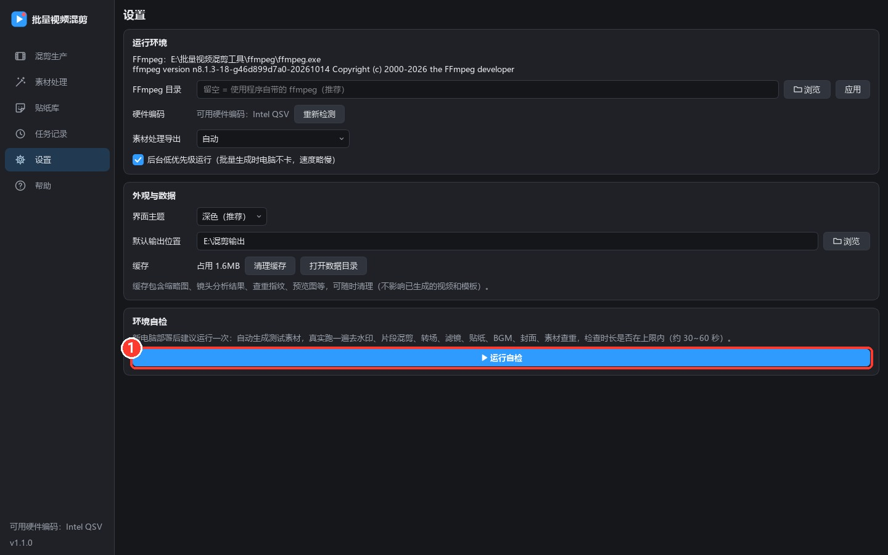

*设置页：① 运行自检*

<!-- pagebreak -->
## 3. 第一批成片：5 步搞定

下面以“**618 好物推荐，生成 20 条，每条不超过 1 分钟**”为例。打开程序后默认就在“混剪生产”页。

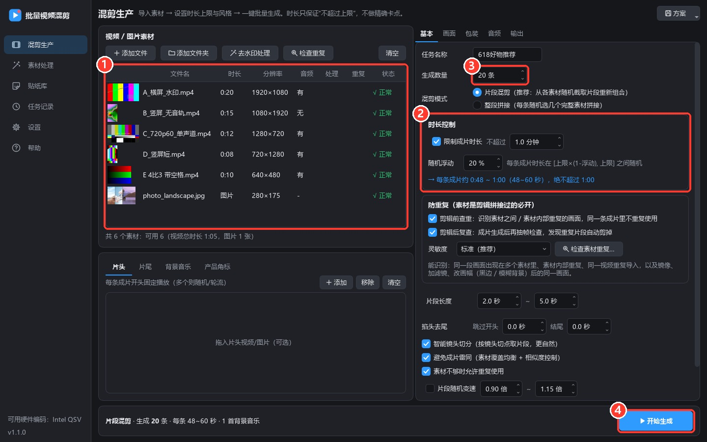

*混剪生产页：① 素材列表　② 时长控制　③ 生成数量　④ 开始生成*

### 第 1 步　导入素材 ①

把视频、图片（或整个文件夹）**直接拖进素材列表**，也可以点“添加文件 / 添加文件夹”。列表会显示缩略图、时长、分辨率、有没有声音；损坏的文件会标红并自动跳过。

片头、片尾、背景音乐、产品角标在列表下方的标签页里添加（都是可选的）。

### 第 2 步　设置时长上限 ②

勾选“限制成片时长”，填 **不超过 1.0 分钟**、**随机浮动 20%**。下方会实时显示“每条成片约 0:48 ~ 1:00”。

> [!TIP]
> 时长只保证**不超过上限**，不做精确卡点：每条在“上限 ×(1 − 浮动)”到“上限”之间随机，最后一个片段自然截短，片头片尾和转场都计算在内。

### 第 3 步　确认“防重复”已勾选

时长控制下方的“防重复”卡片里，“剪辑前查重”和“剪辑后复查”**默认都已勾选，保持即可**。素材是剪辑拼接过的一定要开（详见第 4 章）。

### 第 4 步　填生成数量 ③

例如 20 条。任务名称会用在输出文件夹和文件名里，比如“618好物推荐_001.mp4”。

### 第 5 步　开始生成 ④

点右下角 **开始生成**，右侧切换为进度面板：

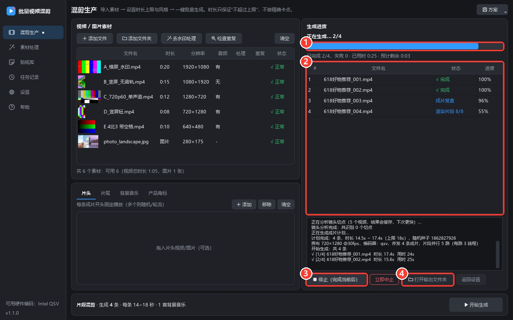

*生成中：① 总进度　② 每条成片的状态　③ 停止（完成当前后）　④ 打开输出文件夹*

- 每条成片依次经过“渲染片段 → 合成成片 → 成片复查 → √ 完成”，下方日志里有详细过程。
- 某条失败会**自动重试一次**；显卡编码出错会自动改用 CPU。
- **停止（完成当前后）**：正在做的几条做完再停；“立即中止”马上结束。之后都可以在“任务记录”里接着做。

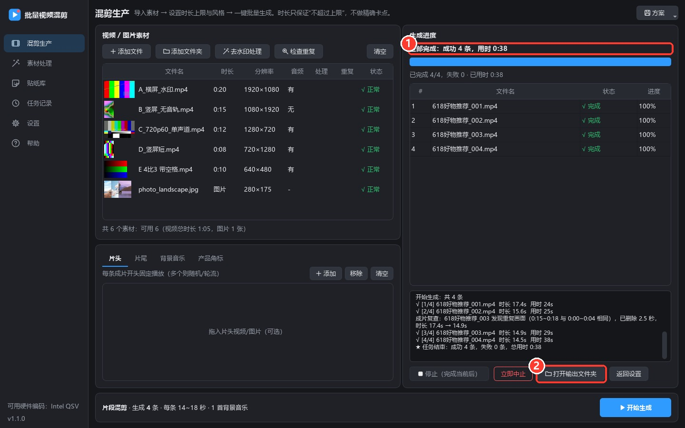

*全部完成：① 结果汇总　② 打开输出文件夹*

点 **打开输出文件夹**：成片在“**成片**”文件夹，封面在“**封面**”文件夹，“数据”文件夹里有报告（report.csv，可用 Excel 打开）和日志。双击进度表里已完成的行可以直接播放。

<!-- pagebreak -->
## 4. 素材是拼接过的？防重复这样用

很多素材本身就是剪辑拼接的：同一段画面可能出现在好几个素材里，或者同一个视频被重复导入。随机混剪时，这些画面可能在一条成片里出现两次。防重复用**两道检查**解决这个问题：

- **剪辑前查重**：开始生成时先给每个素材做画面指纹，找出所有重复画面。同一条成片里，**同一段画面只会出现一次**；几乎完全相同的素材只保留一份。
- **剪辑后复查**：每条成片做完再抽帧检查一遍，找到的相似画面会对照素材原始画面再确认，确实重复的片段**自动剪掉**（成片只会变短，不会超过时长上限）。
- 转码、调色、加字幕、**镜像翻转**、加黑边、**横屏改竖屏（模糊背景）**后的同一画面也能认出；同一镜头里缓慢推拉的画面、口播同一镜头不同时刻的画面不会被误判。

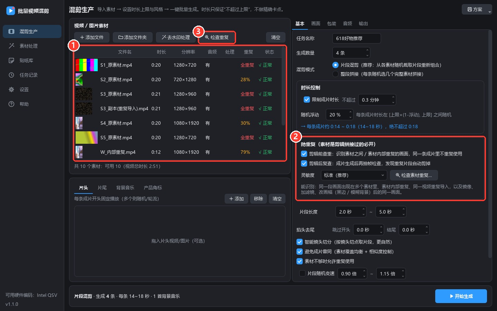

*① “重复”列：每个素材的重复画面占比　② 防重复设置　③ 检查重复*

### 4.1 想先看看哪些素材有重复

点素材栏的 **③ 检查重复**，几秒到几十秒后弹出报告：每一行是一处重复（哪个素材的哪一段和哪个素材的哪一段相同）。“几乎完全重复的素材”可以点 **从素材列表移除完全重复的素材** 一键清理。

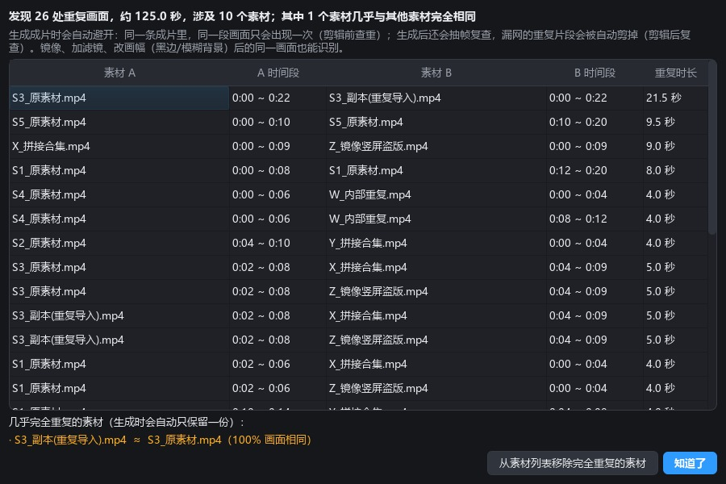 <!-- w=520 -->

*查重报告*

> [!TIP]
> 不点“检查重复”也可以：开始生成时会自动做同样的检查。分析结果会缓存，同一批素材第二次几乎不耗时。

### 4.2 灵敏度怎么选

| 灵敏度 | 什么时候用 |
|---|---|
| **标准（推荐）** | 绝大多数情况 |
| 严格 | 素材之间互相搬运、改动大（镜像 + 滤镜 + 改画幅），希望“很相似也算重复” |
| 宽松 | 同一主播、同一背景的口播素材，觉得限制太多、成片偏短时 |

素材里重复画面太多、能用的画面不够时，成片可能比设定的下限短，日志里会提示：增加素材，或把灵敏度调为“宽松”。

<!-- pagebreak -->
## 5. 去水印 / 去贴纸 / 去遮挡

在素材列表选中素材，点 **去水印处理**（或右键 → 去水印/处理），进入“素材处理”页。

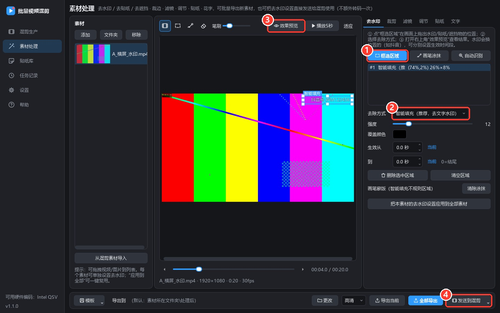

*素材处理：① 框选区域　② 去除方式　③ 效果预览　④ 发送到混剪*

1. 点 **① 框选区域**，在画面上拖出水印 / 贴纸 / 遮挡物的范围（框可以拖动、拉边角调整大小，按 Delete 删除）。
2. **② 去除方式**选“智能填充”（文字水印、台标、小贴纸首选）；大面积遮挡物可选模糊或马赛克。
3. 打开 **③ 效果预览**，看到的就是最终效果。
4. 点 **④ 发送到混剪 → 发送去水印设置**：混剪时直接去水印，不额外转码，画质更好（推荐）。也可以“全部导出”成新素材。

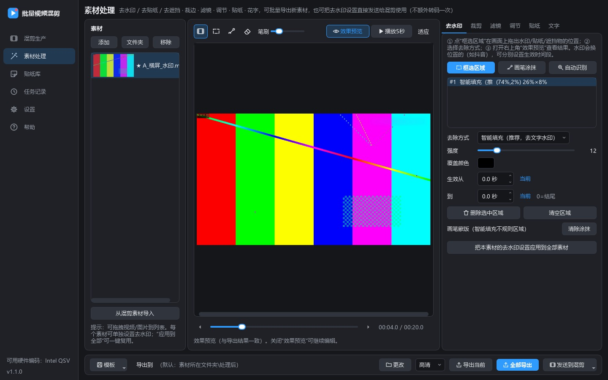

*效果预览：右上角的文字水印已被智能填充*

- **形状不规则**的贴纸、表情：用“画笔涂抹”涂满即可。
- **不知道水印在哪**：点“自动识别”，程序会框出整段视频里“始终不动”的文字/台标，检查后删掉误识别的框。
- **水印中途换位置**：分别框选每个位置，给每个框设置“生效从 … 到 …”。
- **一批同来源的视频**：设置一次，点“把本素材的去水印设置应用到全部素材”；或左下角“模板 → 保存当前去水印设置为模板…”，以后在混剪素材上右键“套用去水印模板…”。
- 顶部/底部的字幕条、黑边：在“裁剪”标签直接裁掉（可“自动检测黑边”）。

<!-- pagebreak -->
## 6. 给成片加包装：标题、贴纸、Logo

在混剪生产页右侧切到 **包装** 标签：

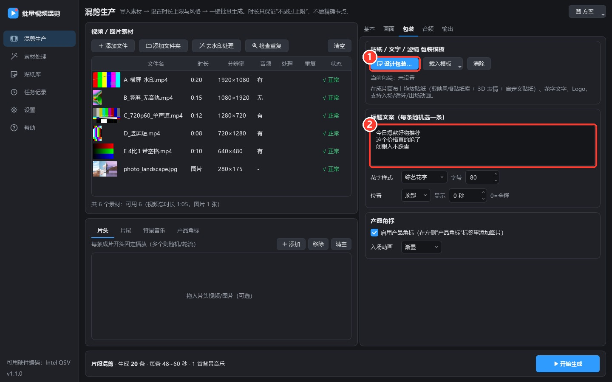

*包装设置：① 设计包装…　② 标题文案（每行一条，每条成片随机选一条）*

点 **① 设计包装…** 打开包装设计器，在成片画布上摆放贴纸、文字和 Logo，每一条成片都会套用：

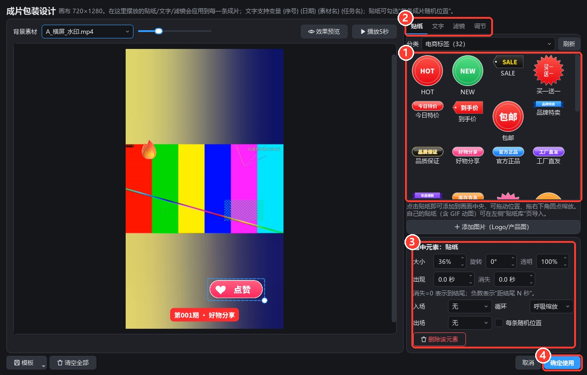

*包装设计器：① 点贴纸即可添加　② 贴纸 / 文字 / 滤镜 / 调节　③ 选中元素的大小、时间、动画　④ 确定使用*

- 贴纸添加后拖动摆位置，拖右下角圆点缩放；③ 里可以设置出现/消失时间和入场、循环、出场动画。
- 文字支持变量：**{序号}**（001、002…）、**{日期}**、**{素材名}**、**{任务名}**，每条成片自动替换。
- 出现时间填**负数**表示“距结尾 N 秒”，例如 −3 = 结尾前 3 秒出现“关注不迷路”。
- 勾选“每条随机位置”，贴纸每条出现在不同位置。
- 满意后点 **④ 确定使用**；常用的包装可以“模板 → 保存”，下次直接载入。

## 7. 贴纸库与自己的贴纸

内置 289 款贴纸：电商标签、互动引导、箭头、装饰、对话气泡（本工具原创）和 202 个 3D 表情（Microsoft Fluent Emoji，MIT 协议），都可以商用。

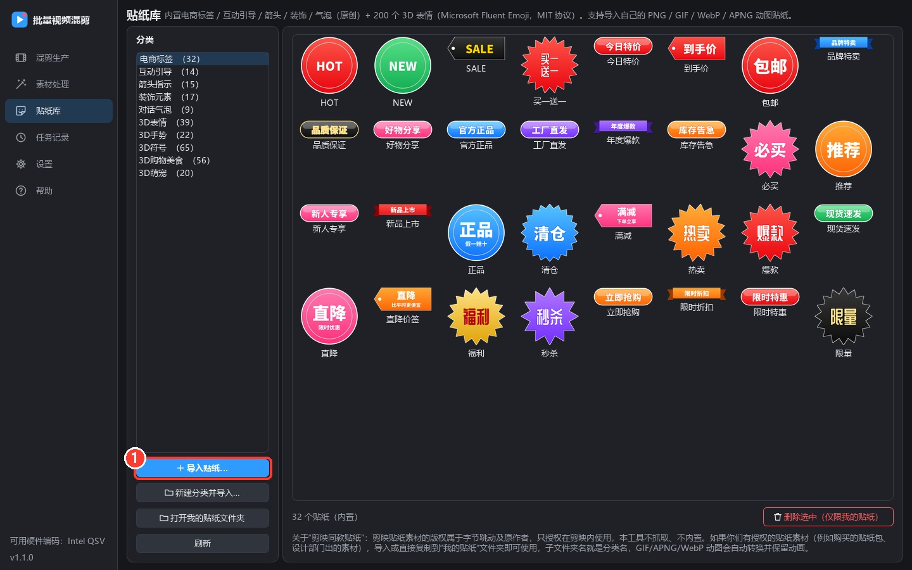

*贴纸库：① 导入贴纸…（支持 PNG / JPG / WebP / GIF 动图）*

点 **① 导入贴纸…** 导入自己的贴纸，GIF / WebP / APNG 动图会保留动画。导入后在包装设计器和素材处理里都能用。

> [!NOTE]
> **关于“剪映同款贴纸”**：剪映贴纸的版权属于字节跳动及原作者，只授权在剪映里使用，本工具不抓取、不内置。你们自己购买或设计的贴纸素材，导入即可使用。

<!-- pagebreak -->
## 8. 停了、断电了怎么办

左侧点 **任务记录**，选中那次任务，点 **② 继续未完成**：按原计划把缺的成片补齐，已完成的不会重做。

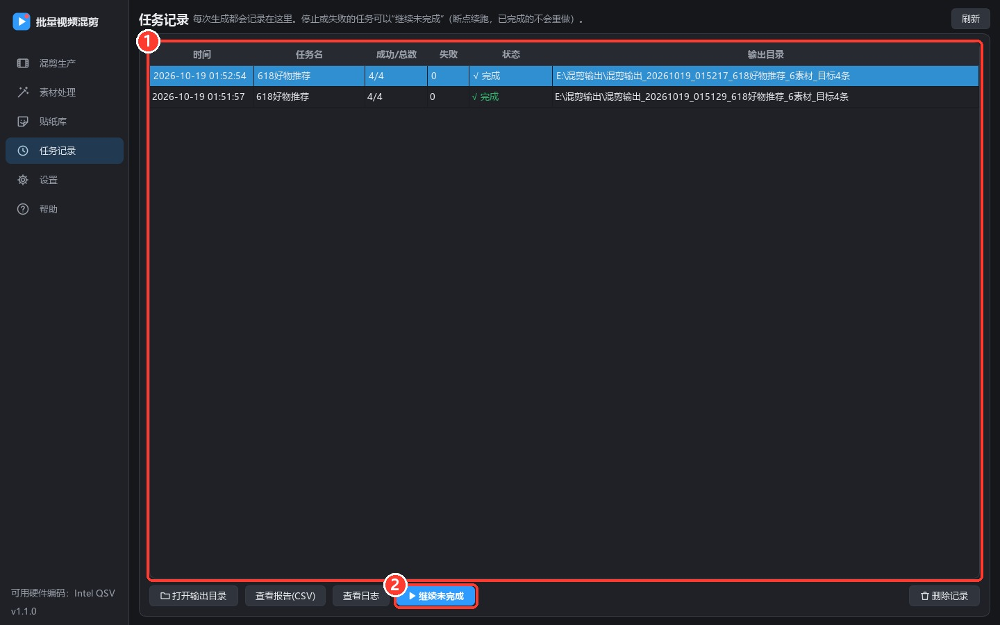 <!-- w=500 -->

*任务记录：① 历次任务　② 继续未完成*

## 9. 推荐设置速查

| 场景 | 推荐设置 |
|---|---|
| 抖音 / 快手 / 视频号 | 画面 → 画面尺寸“竖屏 9:16 · 1080×1920”，比例不一致时“模糊背景填充” |
| 小红书 | 画面尺寸“竖屏 3:4 · 1080×1440（小红书）” |
| 想让成片之间差异大 | 片段混剪 + 避免成片雷同 + 滤镜“每条随机” + 转场“混合随机” + 背景音乐随机起点 |
| 口播 + 背景音乐 | 音频 → 素材原声“原声压低”，开启响度统一 |
| 素材是剪辑拼接的 | 防重复两项保持勾选，灵敏度“标准”；成片偏短时改“宽松” |
| 电脑配置一般 / 生成时很卡 | 画面尺寸“竖屏 9:16 · 720×1280”，编码方式“自动”，设置里开启“后台低优先级运行” |
| 想复现同一批结果 | 输出 → 随机种子填一个固定数字（0 = 每次不同） |
| 不同产品线反复用 | 右上角“方案 → 保存当前方案…”，下次“方案 → 载入方案” |

## 10. 常见问题

**问：成片会不会超过我设的时长？**

答：不会。规划时按帧计算不超过上限，合成时还会再兜底截断；防重复剪掉重复段只会让成片变短。

**问：成片比下限还短？**

答：素材不够，或素材里重复画面太多。增加素材，或把防重复灵敏度调为“宽松”。

**问：速度慢 / 电脑卡？**

答：编码方式选“自动”（会用显卡）；画面尺寸选 720×1280；设置里开启“后台低优先级运行”。

**问：去水印后有模糊痕迹？**

答：框尽量贴合水印（略大一点即可）；大面积遮挡物用“裁剪”裁掉，或盖一个贴纸。

**问：某条显示失败？**

答：已自动重试一次。鼠标停在失败行上看原因，常见是素材损坏、磁盘空间不足；详细信息在“数据\run.log”。

**问：我的设置、模板会丢吗？**

答：不会。都保存在 %APPDATA%\BatchVideoMixer，升级、重装都保留（设置 → 打开数据目录）。

## 11. 使用须知

- 只处理**自有或已获授权**的素材，尊重著作权和各平台规则。
- 去水印功能用于清理自有素材上的旧水印、误加的贴纸或遮挡物，**不要用于去除他人作品的署名水印或搬运他人作品**。
- “防重复”只保证你自己的每条成片内部不出现重复画面，与平台查重无关；本工具不承诺、也不应被用于“过审 / 去重 / 伪原创”。
- 背景音乐、字体、贴纸请使用有版权或可商用的资源（内置资源均可商用）。

*更多参数说明见《使用文档》，程序里“帮助”页也有简要说明。*
