# 批量视频混剪工具 v1.2 · 使用文档

> 适用系统：Windows 10 / 11 64 位（已针对 **Windows 10 IoT 企业版 LTSC 21H2（Build 19044）** 做兼容设计）
> 交付形式：**安装包**（推荐，装完桌面有图标）或 **单文件免安装版**（一个 exe 双击即用）。内置 FFmpeg、字体、贴纸库，无需联网、无需另装任何运行库

---

## 目录

1. [软件简介](#1-软件简介)
2. [安装与启动](#2-安装与启动)
3. [界面总览](#3-界面总览)
4. [5 分钟快速上手](#4-5-分钟快速上手)
5. [混剪生产详解](#5-混剪生产详解)
6. [防重复：素材查重与成片复查](#6-防重复素材查重与成片复查)
7. [素材处理：去水印 / 去贴纸 / 去遮挡 / 滤镜 / 贴纸 / 文字](#7-素材处理)
8. [成片包装设计器](#8-成片包装设计器)
9. [贴纸库](#9-贴纸库)
10. [任务记录与断点续跑](#10-任务记录与断点续跑)
11. [设置与环境自检](#11-设置与环境自检)
12. [输出文件说明](#12-输出文件说明)
13. [性能与配置建议](#13-性能与配置建议)
14. [常见问题](#14-常见问题)
15. [使用规范](#15-使用规范)
16. [附录 A：技术实现要点](#附录-a技术实现要点)
17. [附录 B：快捷键](#附录-b快捷键)
18. [附录 C：第三方组件授权](#附录-c第三方组件授权)
19. [附录 D：版本更新记录](#附录-d版本更新记录)

---

## 1. 软件简介

批量视频混剪工具用于把一批**自有或已授权**的视频/图片素材，按设定规则**自动组合、统一规格、加包装，一次批量产出几十上百条成片**。

**核心能力**

| 能力 | 说明 |
|---|---|
| **时长上限控制** | 每条成片“**不超过 X 分钟**”，可设随机浮动（例如 1 分钟、浮动 20% → 每条 48～60 秒）。只保证不超上限，不做精确卡点。 |
| **防重复（v1.1 新增）** | 素材本身是剪辑拼接过的也不怕：**剪辑前查重**识别素材之间/素材内部重复的画面，同一条成片不重复使用；**剪辑后复查**抽帧再查一遍，发现重复自动去掉（整段拼接时整段移除重复的素材，不拆素材）。 |
| 两种混剪模式 | **整段拼接**（默认推荐：素材从第一帧到最后一帧完整保留、不拆分，随机顺序拼接，转场不占用素材画面）/ **片段混剪**（把素材拆成短片段重新组合，需要时再用） |
| **音画同步（v1.2）** | 声音、字幕和画面严格对齐：素材里声音比画面晚开始、声音中途断档，都会自动补齐，不会越往后错得越多 |
| **电脑不卡（v1.2）** | “生成时电脑负载”三档可选，默认“流畅优先”：生成任务合计最多用约 60% 的 CPU，长时间批量生成也能照常办公 |
| **去水印 / 去贴纸 / 去遮挡** | 框选或画笔涂抹，智能填充 / 模糊 / 马赛克 / 色块覆盖；**自动识别**固定水印；分时间段处理换位置的水印；裁边去字幕条/黑边 |
| 滤镜与调节 | 33 款滤镜（人像/风景/复古/风格/美食/商品六类，可调强度）+ 亮度、对比度、饱和度、色温等 10 项调节 |
| 贴纸库 | 289 款：电商标签、互动引导、箭头、装饰、对话气泡（原创）+ 202 个 3D 表情；支持导入自己的 PNG/GIF/WebP 动图贴纸 |
| 花字文字 | 16 种花字预设（描边/双描边/渐变/阴影/底框）+ 5 款可免费商用字体；支持 {序号} {日期} 等变量 |
| 动画 | 入场：渐显、弹出、缩小、四向滑入；循环：呼吸、弹跳、抖动、摇摆、旋转、漂浮、闪烁；出场：渐隐 |
| 转场 | 叠化转场（溶解、滑动、擦除、圆形展开等 23 种）+ 切换特效（闪白、闪黑、推近、抖动、模糊渐清） |
| 音频 | 原声保留/压低/去除，背景音乐随机选曲、随机起点、自动循环，响度统一（EBU R128），结尾淡出 |
| 画面适配 | 竖屏/横屏/方形多种规格；比例不一致时**模糊背景填充** / 黑边 / 裁剪铺满 / 智能选择 |
| 效率 | 显卡硬件编码（NVIDIA / Intel / AMD，实测可用才启用，失败自动回退 CPU）、多路并行、断点续跑、失败自动重试 |
| 可追溯 | 每个任务自动保存参数、计划、查重结果、日志、CSV 报告、封面 |


*上图：同一批素材生成的 4 条成片（标题随机、贴纸/文字/角标自动排版、序号自动递增、角标随机四角）。*

---

## 2. 安装与启动

### 2.1 两种版本怎么选

最新版本在 [GitHub Releases](https://github.com/lxk7-ui/BatchVideoMixer/releases) 下载（GitHub 上的文件名是英文：安装版为 `BatchVideoMixer-Setup-v1.2.0.exe`，免安装版为 `BatchVideoMixer-Portable-v1.2.0.exe`）。

| 版本 | 文件 | 适合 |
|---|---|---|
| **安装版（推荐）** | `批量视频混剪工具_安装包_v1.2.0.exe`（约 116MB） | 长期使用。装完桌面有图标、开始菜单有入口，可正常卸载；**不需要管理员权限** |
| 免安装版 | `批量视频混剪工具_免安装版_v1.2.0.exe`（约 156MB） | 临时使用、U 盘随身带。只有一个文件，双击即用，不用安装 |

两个版本功能完全一样，设置、方案、模板、贴纸、任务记录都保存在同一个位置（见 2.6），可以随时互换。

### 2.2 安装版

1. 双击 `批量视频混剪工具_安装包_v1.2.0.exe`。
2. 选择安装位置（默认 `C:\Users\你的用户名\AppData\Local\Programs\批量视频混剪工具`，可改到 D 盘），保持勾选“创建桌面快捷方式”，点“安装”。
3. 安装完成后勾选“立即运行”即可打开。以后从**桌面图标**或**开始菜单**打开。
4. **卸载**：Windows“设置 → 应用 → 应用和功能 → 批量视频混剪工具 → 卸载”（或控制面板“程序和功能”）。卸载不会删除你的方案、模板、贴纸和已生成的视频。
5. **升级**：直接运行新版本安装包覆盖安装即可，数据全部保留。

> 默认只为当前用户安装，公司电脑没有管理员权限也能装。管理员可以在安装开始时选择“为所有用户安装”。

### 2.3 免安装版

1. 把 `批量视频混剪工具_免安装版_v1.2.0.exe` 放在任意位置（桌面、D 盘、U 盘都行），双击打开。
2. **第一次打开**会出现“首次启动，正在准备程序文件”进度窗口，约 10～30 秒（只有第一次）。程序文件会解压到系统的隐藏目录 `%LOCALAPPDATA%\BatchVideoMixer\app`，不会在你放 exe 的地方多出任何文件夹。
3. 之后每次打开约 3～5 秒。换新版本时会自动清理旧版本的文件。
4. 需要 C 盘至少 500MB 可用空间。

### 2.4 首次启动可能遇到的提示

| 提示 | 处理方法 |
|---|---|
| “Windows 已保护你的电脑”（SmartScreen） | 点 **更多信息 → 仍要运行**。原因是程序没有购买代码签名证书，属正常现象。 |
| 杀毒软件拦截/隔离 | 把程序加入杀软信任区（白名单）。免安装版因为会自解压，个别杀软更敏感，被拦时建议改用**安装版**。程序不联网、不修改系统。 |
| “使用须知”对话框 | 阅读后勾选“我已阅读并同意”，点“开始使用”（只出现一次）。 |

### 2.5 Windows 10 IoT 企业版 LTSC 说明

- 程序基于 Python 3.12 + Qt 6.8 + FFmpeg 8.1，全部自带，**不需要安装 .NET、VC 运行库或任何解码器**（免安装版的启动器使用 Windows 自带的 .NET Framework 4.8）。
- LTSC 系统没有“电影和电视”应用，程序的预览播放使用自带的播放器（ffplay），不依赖系统播放器。
- 界面字体优先用系统的“微软雅黑”；若系统没有，会自动使用内置的思源黑体。

### 2.6 数据保存位置

设置、方案、模板、我的贴纸、任务记录、缓存都保存在 `%APPDATA%\BatchVideoMixer`（在资源管理器地址栏输入这个路径即可打开，或在程序“设置 → 打开数据目录”）。升级、重装、两种版本互换都不会丢。生成的视频保存在你指定的输出位置（默认 `桌面\混剪输出`）。

> 从 v1.0 绿色版升级：把旧程序文件夹里 `data` 文件夹中的全部内容复制到 `%APPDATA%\BatchVideoMixer`（先打开一次新版程序再复制），原来的方案、模板、我的贴纸、任务记录就都回来了。旧的绿色版文件夹之后可以删除。

### 2.7 部署后先做一次“环境自检”

打开 **设置 → 环境自检 → 运行自检**（约 30～60 秒）。程序会自动生成测试素材，真实跑一遍“去水印 + 片段混剪 + 转场 + 滤镜 + 贴纸 + BGM + 封面 + 素材查重”，并检查成片时长是否在上限内。全部显示“√”即可放心使用。

---

## 3. 界面总览


左侧导航共 6 个页面：

| 页面 | 用途 |
|---|---|
| **混剪生产** | 主页面：导入素材、设置参数、检查重复、批量生成、查看进度 |
| **素材处理** | 去水印/去贴纸/去遮挡、裁边、滤镜、调节、贴纸、文字；可单独导出，也可把设置发送给混剪 |
| **贴纸库** | 浏览内置贴纸，导入自己的贴纸 |
| **任务记录** | 历次任务、打开输出、查看报告/日志、**继续未完成** |
| **设置** | FFmpeg、显卡编码检测、生成时电脑负载、主题、缓存、环境自检 |
| **帮助** | 快速说明与授权信息 |

左下角会显示本机可用的显卡编码（例如“可用硬件编码：Intel QSV”）。

---

## 4. 5 分钟快速上手

1. **导入素材**：在“混剪生产”页，把视频/图片（或整个文件夹）直接**拖进素材列表**。列表会显示缩略图、时长、分辨率、是否有音轨，损坏的文件会标红并自动跳过。
2. **设置时长**：在右侧“基本”标签，混剪模式保持 **整段拼接**（默认：素材完整保留、随机顺序拼接），“时长控制”里填 **不超过 1 分钟**、**浮动 20%**，下方会实时显示“每条成片约 0:48～1:00”。
3. **确认防重复**：“防重复”卡片里的“剪辑前查重”“剪辑后复查”默认已勾选（素材是剪辑拼接过的一定要保持勾选）。
4. **设置数量**：“生成数量”填 20。
5. （可选）在左下角“背景音乐”标签拖入几首音乐；在“包装”标签写几行标题文案。
6. 点右下角 **开始生成**。右侧会切换为进度面板，显示每一条的状态和日志。
7. 全部完成后点 **打开输出文件夹**，成片在“成片”子文件夹里，封面在“封面”子文件夹里。

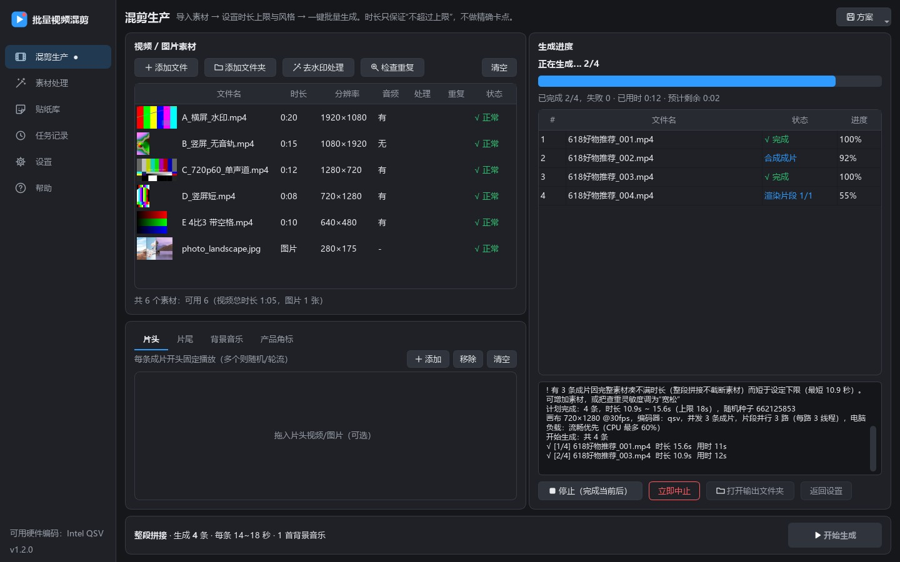

---

## 5. 混剪生产详解

### 5.1 素材

- **支持格式**：视频 mp4 / mov / mkv / avi / flv / wmv / m4v / webm / ts / mts / 3gp / mpg 等；图片 png / jpg / jpeg / bmp / webp。
- **导入方式**：拖拽文件或文件夹（自动递归子文件夹）、“添加文件”、“添加文件夹”。
- **图片素材**：每张显示 N 秒（“基本 → 图片素材时长”），并自动缓慢推拉（Ken Burns 效果）。
- **右键菜单**：去水印/处理、套用去水印模板、清除去水印设置、设为片头、设为片尾、打开所在文件夹、播放预览、从列表移除。按 `Delete` 键可删除选中素材。
- **自动兼容**：手机竖拍的旋转视频、HDR 视频（自动转为普通动态范围，避免发灰）、奇数分辨率、可变帧率、59.94 帧、无音轨视频（自动补静音）都能直接用。
- “处理”列显示“去水印”表示该素材已设置去水印，生成时会在剪辑过程中直接处理（不额外转码一次，画质更好）。
- “重复”列显示该素材里有多少画面在别处也出现过（点“检查重复”后显示，见第 6 章）。

### 5.2 片头 / 片尾 / 背景音乐 / 产品角标（左下角标签）

| 标签 | 说明 |
|---|---|
| 片头 | 每条成片开头固定播放。多个片头时“随机选择”或“轮流使用”（基本 → 多个片头/片尾时随机选择）。片头时长计入时长上限。 |
| 片尾 | 每条成片结尾固定播放，同上。 |
| 背景音乐 | 每条随机选一首；音乐短于成片会自动循环，可随机起点；开头 0.8 秒淡入。 |
| 产品角标 | 产品图/Logo 每条随机选一张，随机出现在四个角（自动避开其它贴纸/文字），白底/黑底自动去除。 |

### 5.3 基本参数

| 参数 | 说明 |
|---|---|
| 任务名称 | 用于输出文件夹名与文件命名 |
| 生成数量 | 1～9999 条 |
| 混剪模式 | **整段拼接（默认）**：每条从素材里随机挑选、按随机顺序拼接，**每个素材从第一帧到最后一帧完整保留，不拆分、不掐头去尾**（除非你设置了“掐头去尾”）；有时长上限时只挑放得下的完整素材（可选不限时长）。**片段混剪**：从各素材随机截取 2～5 秒（可调）的片段重新组合，组合空间大、成片差异大，需要拆分素材时再用。 |
| **时长控制** | **不超过 X 分钟**（可填小数，如 0.5 = 30 秒），**随机浮动 F%**：每条成片的目标时长在 `[X×(1−F), X]` 之间随机。详见下方规则。 |
| **防重复** | 剪辑前查重、剪辑后复查、灵敏度、检查素材重复，详见第 6 章。 |
| 片段长度 | 片段混剪时每个片段的时长范围 |
| 每条素材数 | 整段拼接时每条大约用几个素材（参考值：挑够了但还没到时长下限，会继续加放得下的素材）。“放不下时截掉素材结尾”默认关闭：只用放得下的完整素材，绝不超时 |
| 掐头去尾 | 跳过每个素材开头/结尾 N 秒（例如平台片尾 Logo 动画常在最后 3～4 秒） |
| 智能镜头切分 | 自动分析素材的镜头切换点，片段尽量从镜头切点开始/结束，画面更自然（与查重同一遍分析，结果会缓存） |
| 避免成片雷同 | 素材使用量均衡 + 成片相似度检测，尽量让每条用到不同的素材区间 |
| 素材不够时允许重复 | 素材总时长不足以填满时，允许重复使用片段；关闭则成片会偏短 |
| 片段随机变速 | 每个片段随机 0.9～1.15 倍速（声音音调不变） |

**时长控制规则（重点）**

- 每条成片先在 `[上限 × (1 − 浮动), 上限]` 之间随机一个目标时长，再用片段填充；**最后一个片段按剩余时间自然截短**。
- 片头、片尾、转场重叠都会计算在内；最终合成时还会再按目标时长兜底截断，所以**绝不会超过上限**。
- **整段拼接**：只挑放得下的完整素材（转场时长也算在内），不会为了凑时长去截断素材，所以成片可能短于下限；素材全都比上限还长时，才从最短的那个素材开头截取到上限。
- 例：上限 1 分钟、浮动 20% → 每条在 48～60 秒之间；浮动 0% → 每条都尽量接近 60 秒但不超过。
- 素材实在太少（或不重复的画面不够）时，成片可能低于下限，日志里会给出提示。

### 5.4 画面

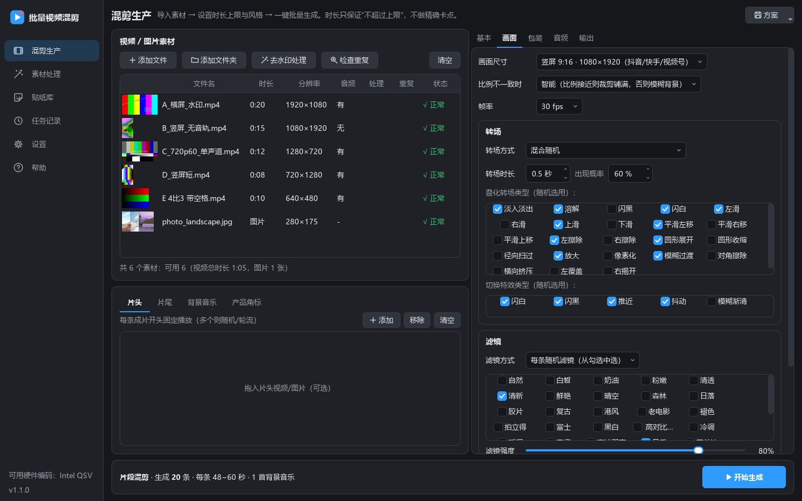

| 参数 | 说明 |
|---|---|
| 画面尺寸 | 竖屏 1080×1920（抖音/快手/视频号）、竖屏 720×1280（体积小）、3:4 1080×1440（小红书）、方形 1080×1080、横屏 1920×1080、横屏 1280×720、跟随第一个素材 |
| 比例不一致时 | **智能**（比例接近则裁剪铺满，否则模糊背景）、**模糊背景填充**（横屏素材放竖屏时最常用）、黑边填充、裁剪铺满 |
| 帧率 | 24 / 25 / 30 / 50 / 60 |
| 转场方式 | 无转场（硬切）/ 切换特效（闪白、闪黑、推近、抖动、模糊渐清，速度快）/ 叠化转场（溶解、滑动、擦除等）/ 混合随机。可勾选参与随机的类型，设置转场时长与出现概率。整段拼接时转场为**定格过渡**：用前一个素材的最后一帧和后一个素材的第一帧做过渡，不占用素材画面（每个转场让成片多出转场时长）；切换特效会换成效果相近的过渡。 |
| 滤镜 | 不加 / 统一使用一个 / 每条随机（从勾选的滤镜中随机），可调强度 |
| 画面变体 | 关闭 / 轻微 / 中等 / 较强（轻微调色、颗粒、放大裁边），用于多版本 A/B 测试；水平镜像默认关闭（会让画面文字反向） |

### 5.5 包装

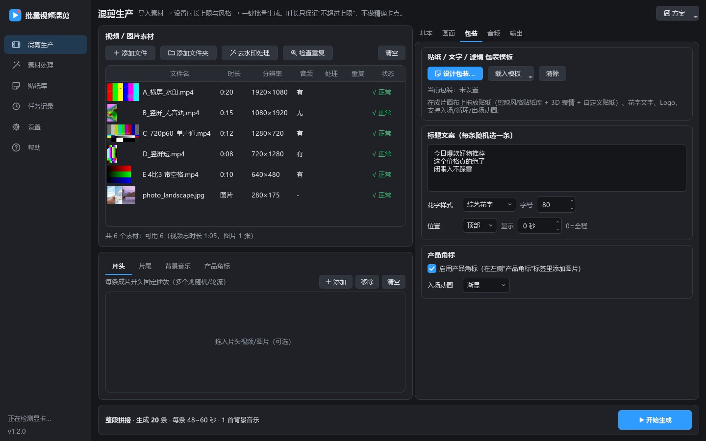

- **设计包装…**：打开“成片包装设计器”，在成片画布上摆放贴纸、文字、Logo，设置滤镜与调节（见第 8 章）。也可“载入模板”。
- **标题文案**：每行一条，每条成片随机选一条，花字样式、字号、位置（顶部/中间/底部）、显示时长（0 = 全程）可调，入场自带“弹出”动画。
- **产品角标**：启用后，从左下角“产品角标”中随机选图，随机放在四角，入场动画可选。

### 5.6 音频

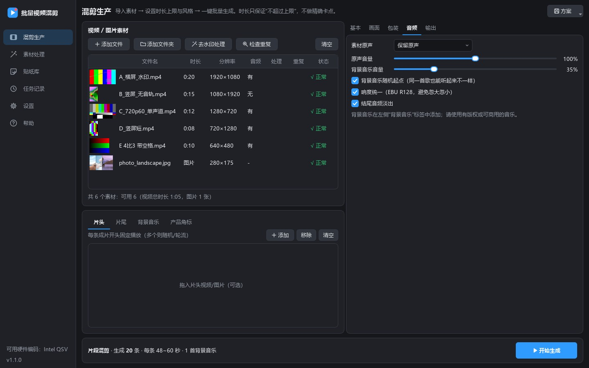

| 参数 | 说明 |
|---|---|
| 素材原声 | 保留原声 / 原声压低（配合背景音乐，口播+BGM 常用）/ 去掉原声 |
| 原声音量、背景音乐音量 | 0%～200% / 0%～150% |
| 背景音乐随机起点 | 同一首歌每条从不同位置开始 |
| 响度统一 | EBU R128 标准（−16 LUFS），避免忽大忽小 |
| 结尾音频淡出 | 最后 1.2 秒淡出 |

### 5.7 输出

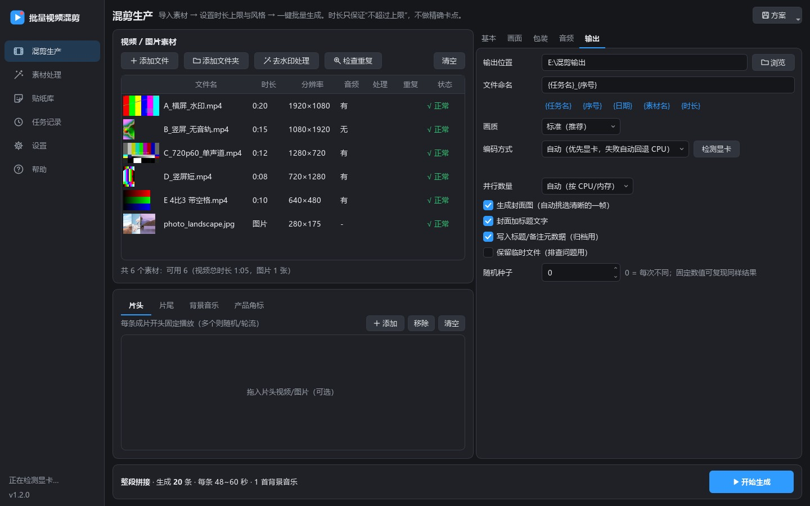

| 参数 | 说明 |
|---|---|
| 输出位置 | 默认 `桌面\混剪输出`，每次任务自动新建一个文件夹（时间精确到秒，不会互相覆盖） |
| 文件命名 | 可用变量：`{任务名}` `{序号}` `{日期}` `{素材名}` `{时长}`，例如 `{任务名}_{序号}` → `618好物推荐_001.mp4` |
| 画质 | 高清（文件较大）/ 标准（推荐）/ 省空间。统一输出 H.264 + AAC 的 MP4（快速起播），各平台通用 |
| 编码方式 | 自动（优先显卡，失败自动回退 CPU）/ CPU / NVIDIA / Intel / AMD。“检测显卡”会实际试编码，只有真正可用才启用 |
| 并行数量 | 自动（按 CPU 核数和可用内存）或手动 1～8 路 |
| 生成封面 | 自动挑选清晰、亮度适中的一帧做封面；可加标题（成片全程已有标题时不重复叠加） |
| 写入元数据 | 写入标题/备注，便于归档 |
| 随机种子 | 0 = 每次不同；填固定数字可复现完全相同的结果 |

### 5.8 生成、停止与方案

- **开始生成**后右侧显示总进度、预计剩余时间、每条的阶段（渲染片段 / 合成成片 / 成片复查 / 完成）和日志。双击已完成的行可直接播放。
- **停止（完成当前后）**：正在处理的几条做完再停；**立即中止**：马上结束（已完成的不受影响）。之后可在“任务记录”里继续。
- 某条失败会**自动重试一次**；显卡编码出错会自动切换为 CPU 编码继续。
- 生成期间电脑不会自动睡眠；关闭程序会提示确认。
- 右上角 **方案**：保存/载入整套参数（含素材列表），适合不同产品线复用；程序关闭时会自动记住上次的设置。

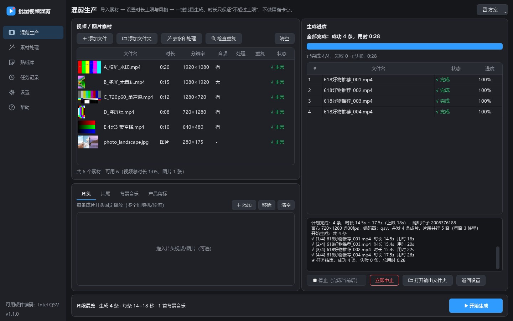

---

## 6. 防重复：素材查重与成片复查

### 6.1 为什么需要

很多素材本身就是**剪辑拼接**过的：同一段画面可能同时出现在好几个素材里，或者在同一个素材里出现两次；也有同一个视频被重复导入、或被镜像/加滤镜/改成竖屏后又出现。如果不处理，随机混剪时同一段画面就可能在一条成片里出现两次。

本工具用**两道检查**保证每条成片里**尽量不出现重复片段**：

| 检查 | 什么时候 | 做什么 |
|---|---|---|
| **剪辑前查重** | 开始生成时（先于规划） | 给每个素材做画面指纹，找出所有重复画面段，并给“同一画面”编上同一个内容编号。规划每条成片时，同一个内容编号只允许用一次；整段拼接时，与本条已用画面有重复的素材整个跳过（不拆素材）。几乎完全相同的素材（如重复导入）只保留一份。 |
| **剪辑后复查** | 每条成片生成后 | 再对成片抽帧检查一遍，找到的相似画面会**对照素材原始画面再确认**，确实是同一段画面才处理：片段混剪把**后出现的那一段剪掉**（最多检查 3 轮）；整段拼接把**后出现的那个素材整段移除**后重新合成，不拆素材。 |

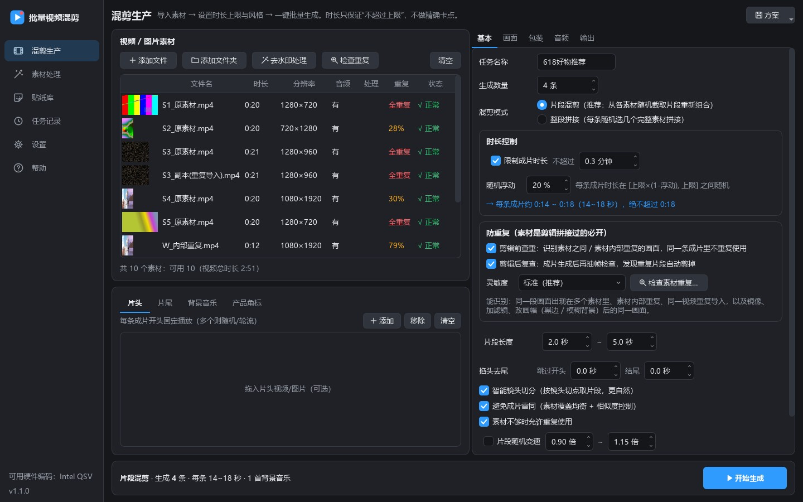

*上图：基本设置里的“防重复”卡片，以及素材列表的“重复”列。*

### 6.2 能识别哪些重复

- 同一段画面出现在**多个素材**里（剪辑合集、拼接素材）；
- **同一个素材内部**重复出现的片段；
- **同一视频重复导入**（文件名不同也能认出，自动只保留一份）；
- 经过**转码、缩放、调色/滤镜、加字幕或水印**后的同一画面；
- **镜像翻转**、**加黑边**、**横屏改竖屏（模糊背景）** 后的同一画面。

不会被误判为重复的情况：同一个连续镜头里缓慢变化的画面（缓推、缓移、商品转台）、口播/固定机位同一镜头不同时刻的画面、横屏素材放进竖屏后因模糊背景而“看起来像”的不同画面、纯黑/纯色过渡帧、画面完全不同的素材。

> 原理：每 0.5 秒抽一帧，自动裁掉黑边/模糊背景，计算 64 位感知指纹（同时算镜像指纹）；**连续 1.5 秒以上都相同**才判定为重复，偶然的相似不会误判。

### 6.3 检查素材重复（查看报告）

在混剪页素材栏点 **检查重复**（或“防重复”卡片里的“检查素材重复…”），程序会分析当前全部素材并显示报告：

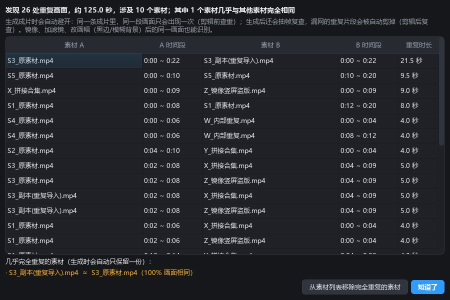

- 每一行是一处重复：哪个素材的哪一段，与哪个素材的哪一段相同、重复多长。
- 下方列出“几乎完全重复的素材”，可点 **从素材列表移除完全重复的素材** 一键清理。
- 素材列表的“重复”列显示每个素材的重复画面占比（“全重复”表示整个素材在别处都有）。

不点“检查重复”也没关系：开始生成时会自动做同样的分析。分析结果会缓存，同一批素材第二次几乎不耗时。

### 6.4 灵敏度怎么选

| 灵敏度 | 适合 |
|---|---|
| **标准（推荐）** | 绝大多数情况 |
| 严格 | 素材大量互相搬运、改动较大（镜像+滤镜+改画幅等），希望“很相似也算重复” |
| 宽松 | 素材多是同一场景（例如同一主播同一背景的口播），标准档下觉得限制太多、成片偏短时使用 |

### 6.5 注意事项

- 素材里重复画面很多、能用的“不重复画面”不够时，成片可能短于设定下限，日志会提示；可以增加素材，或把灵敏度调为“宽松”。
- **画面基本静止的短素材**（单张图片推拉、商品特写，15 秒以内）在同一条成片里只用一次；长的静止素材（口播、固定机位）可以再用，但两次取用会在素材里相隔至少 8 秒。
- 剪辑后复查删除重复内容时会重新编码一次（画质损失很小），成片时长会相应变短（仍在上限内），日志里会写明删了哪一段（整段拼接时写明移除了哪个素材）。
- 实测：10 个含大量重复的剪辑拼接素材，**关闭防重复时**，片段混剪 6 条里 4 条含重复（合计约 11 秒）、整段拼接 6 条里 5 条含重复（合计约 74 秒）；**开启后两种模式都是 0 条含重复**，复查没有误删正常画面。只开“剪辑后复查”时也能去掉这些重复（整段拼接是把重复的素材整段移除：5 条成片各移除 1～2 个素材后不再含重复，素材都没被拆开）。用 8 段完全不同的实拍照片推拉视频测试误判，没有被误判为重复。
- 每个任务的 `数据\素材查重.json` 记录了本次识别出的全部重复画面，便于核对。

---

## 7. 素材处理

在混剪页选中素材点“去水印处理”（或右键 → 去水印/处理），即可进入“素材处理”页。也可以直接在该页拖入素材。

### 7.1 框选去水印 / 去贴纸 / 去遮挡

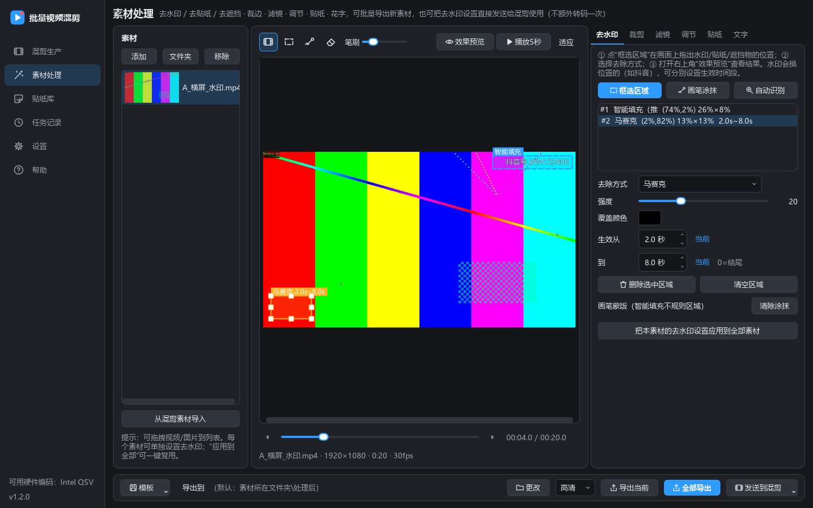

1. 点 **框选区域**（或按 `R`），在画面上拖出水印/贴纸/遮挡物的范围。框可以拖动、拖边角调整大小，按 `Delete` 删除。
2. 在右侧选择 **去除方式**：

| 方式 | 适合 |
|---|---|
| **智能填充**（推荐） | 文字水印、台标、小贴纸：用周围画面自动修补 |
| 高斯模糊 | 较大的遮挡物、人脸/车牌等隐私信息 |
| 马赛克 | 需要明确“打码”的场景 |
| 纯色覆盖 | 纯色背景上的文字（可选颜色） |

3. 打开右上角 **效果预览**，看到的就是最终导出/混剪的效果；关闭后可继续编辑。

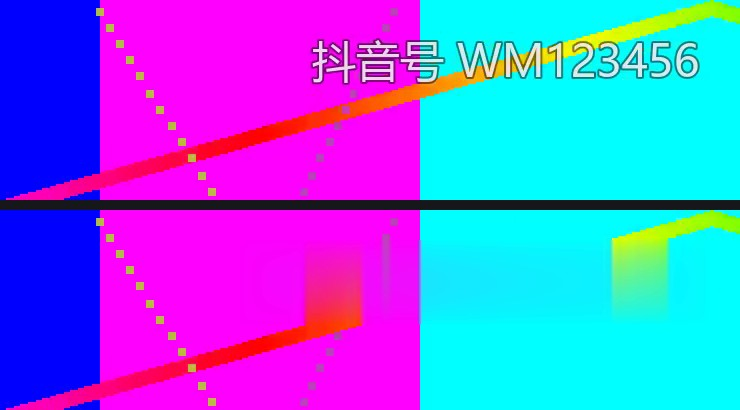 <!-- w=420 -->

*上图：右上角文字水印“智能填充”前（上）后（下）。*

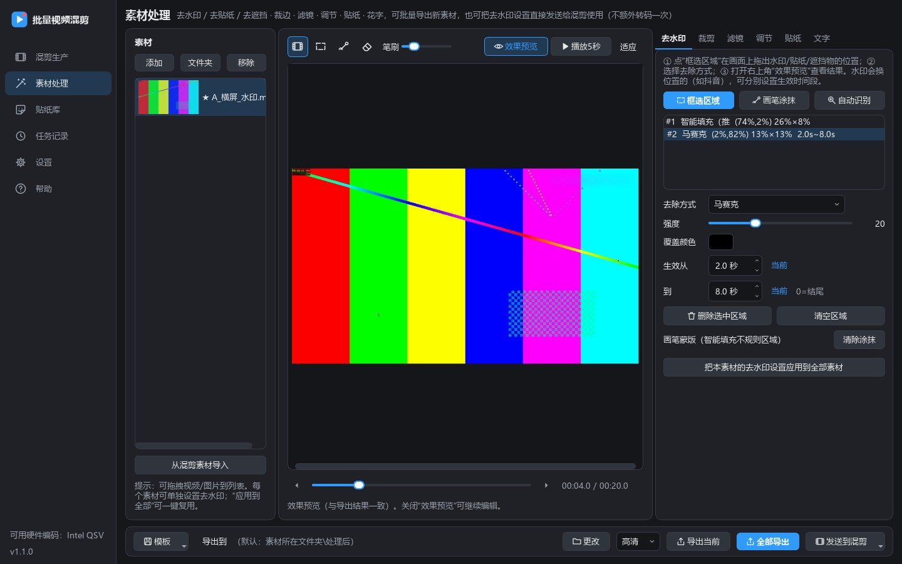

### 7.2 画笔涂抹（不规则形状）

形状不规则的贴纸、表情、遮挡物，点 **画笔**（`B`）直接涂满即可，涂错用 **橡皮**（`E`）擦掉，笔刷大小可调。涂抹区域使用智能填充。

### 7.3 自动识别水印

点 **自动识别**，程序会分析整段视频中“始终不动”的文字/台标/贴纸，自动框出疑似水印位置（通常 1～3 秒）。请检查后删除误识别的框（画面本身静止的视频可能会误识别）。

### 7.4 生效时间段（换位置的水印）

部分平台水印会中途换位置（例如前半段在左上、后半段在右下）。给每个框设置 **生效从 … 到 …**（秒，“到”=0 表示到结尾），可点“当前”直接取时间轴的位置。

### 7.5 裁剪

“裁剪”标签可裁掉画面四边（如顶部水印、底部字幕条、黑边），**自动检测黑边**一键识别。导出时自动放大回原尺寸；混剪时按成片规格重新适配。

### 7.6 滤镜 / 调节

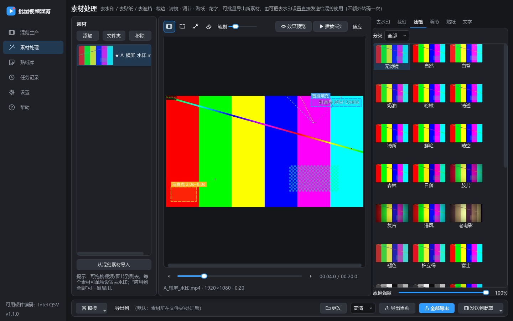

滤镜缩略图直接用当前素材画面生成，所见即所得；强度可调。“调节”包含亮度、对比度、饱和度、色温、色调、高光、阴影、锐化、暗角、颗粒。

### 7.7 贴纸 / 文字 / 图片

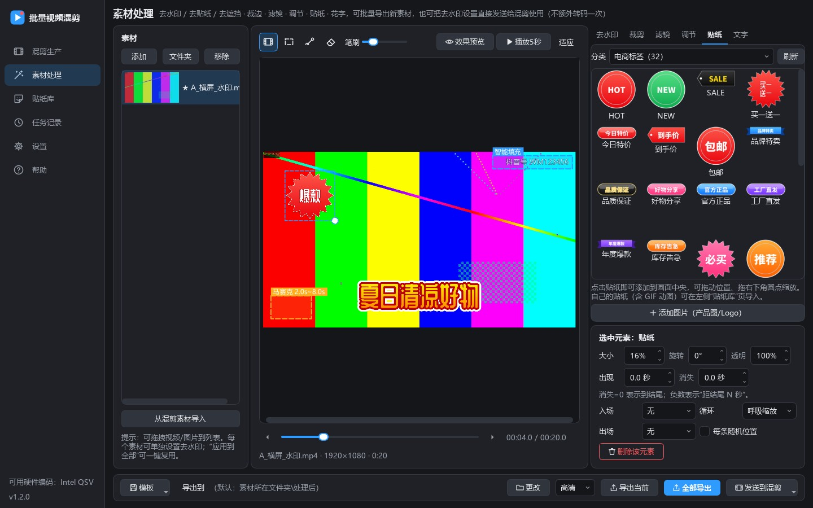

- **贴纸**：选分类，点贴纸即添加到画面中央；拖动移动，拖右下角圆点缩放。
- **文字**：输入文字，选花字预设或自定义字体/颜色/描边/渐变/阴影/底框，点“添加文字到画面”。选中文字后修改样式会实时更新。
- **图片**：“添加图片（产品图/Logo）”，白底/黑底自动去除。
- 选中元素后，下方可设置 **大小、旋转、透明度、出现/消失时间、入场/循环/出场动画**。点“播放5秒”可看动画效果。

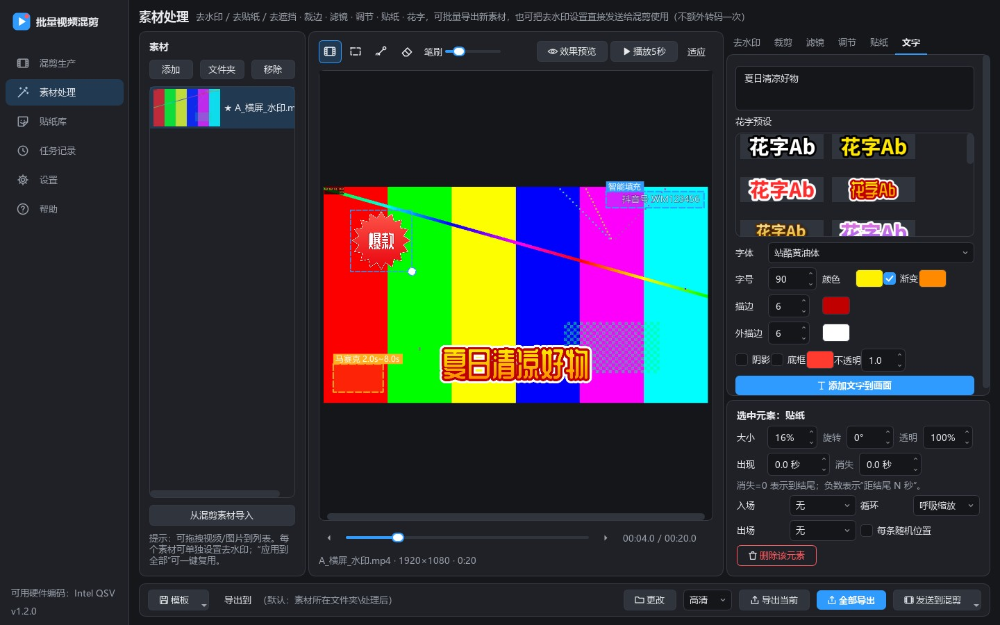

### 7.8 导出、发送到混剪、模板

| 操作 | 说明 |
|---|---|
| 导出当前 / 全部导出 | 生成处理后的新素材（默认保存到素材所在文件夹的“处理后”子文件夹，可“更改”），文件名带“_处理” |
| 发送到混剪 → 发送去水印设置 | 把去水印/裁边设置交给混剪，在混剪时直接处理（**推荐**：不额外转码，画质更好、更省时间） |
| 发送到混剪 → 设为成片包装 | 把滤镜/贴纸/文字设为混剪的成片包装 |
| 把本素材的去水印设置应用到全部素材 | 同一来源、水印位置相同的一批视频，设置一次即可（坐标按比例换算，分辨率不同也适用） |
| 模板 → 保存/载入去水印模板 | 例如保存为“某平台水印-竖屏”，以后在混剪素材上**右键 → 套用去水印模板** |
| 模板 → 保存/载入包装模板 | 滤镜+调节+贴纸+文字整体保存，在混剪“包装”里载入 |

---

## 8. 成片包装设计器

在“混剪生产 → 包装 → 设计包装…”打开。画布就是成片的实际比例（可切换背景素材和时间点）。

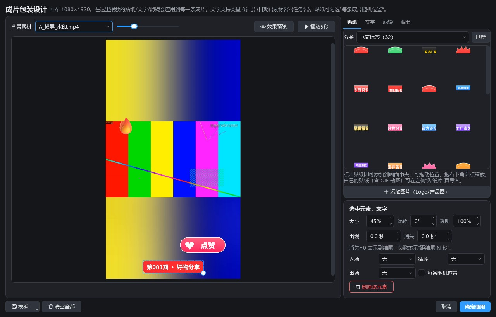

- 贴纸、文字、Logo 的摆放方式与素材处理页相同；**文字支持变量**：`{序号}`（001、002…）、`{日期}`、`{素材名}`、`{任务名}`、`{时长}`，每条成片自动替换。
- 勾选“每条随机位置”的贴纸，每条成片会出现在不同位置。
- 出现/消失时间可设负数，表示“距结尾 N 秒”（例如结尾前 3 秒出现“关注不迷路”）。
- “效果预览”显示最终效果，“播放5秒”渲染带动画的小样。
- 点“确定使用”应用到当前混剪任务；也可保存为模板。

---

## 9. 贴纸库

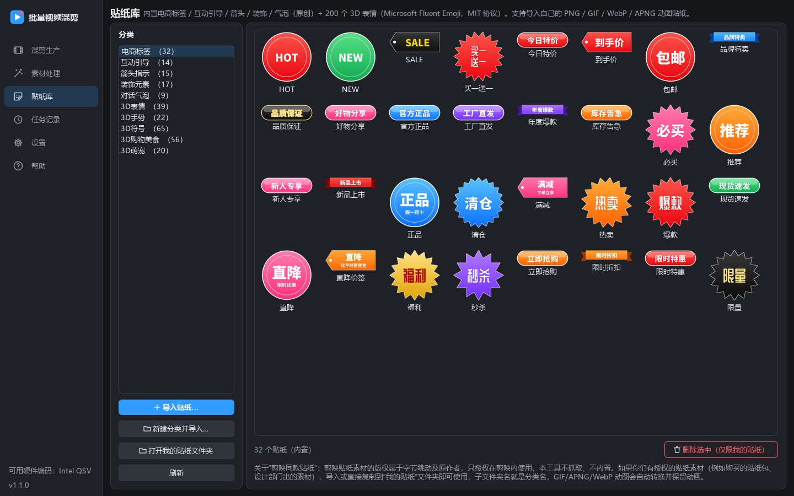

| 分类 | 数量 | 来源 |
|---|---|---|
| 电商标签（爆款、限时特惠、包邮、到手价、买一送一…） | 32 | 本工具原创，可商用 |
| 互动引导（点赞、关注、收藏、一键三连、点击下方链接…） | 14 | 本工具原创 |
| 箭头指示（箭头、弧形箭头、手绘圈、下划线、箭头组） | 15 | 本工具原创 |
| 装饰元素（闪光星、放射线、彩色纸屑、“哇”“绝了”“YYDS”等花字贴） | 17 | 本工具原创 |
| 对话气泡 | 9 | 本工具原创 |
| 3D 表情 / 手势 / 符号 / 购物美食 / 萌宠 | 202 | Microsoft Fluent Emoji（MIT 协议，可商用） |

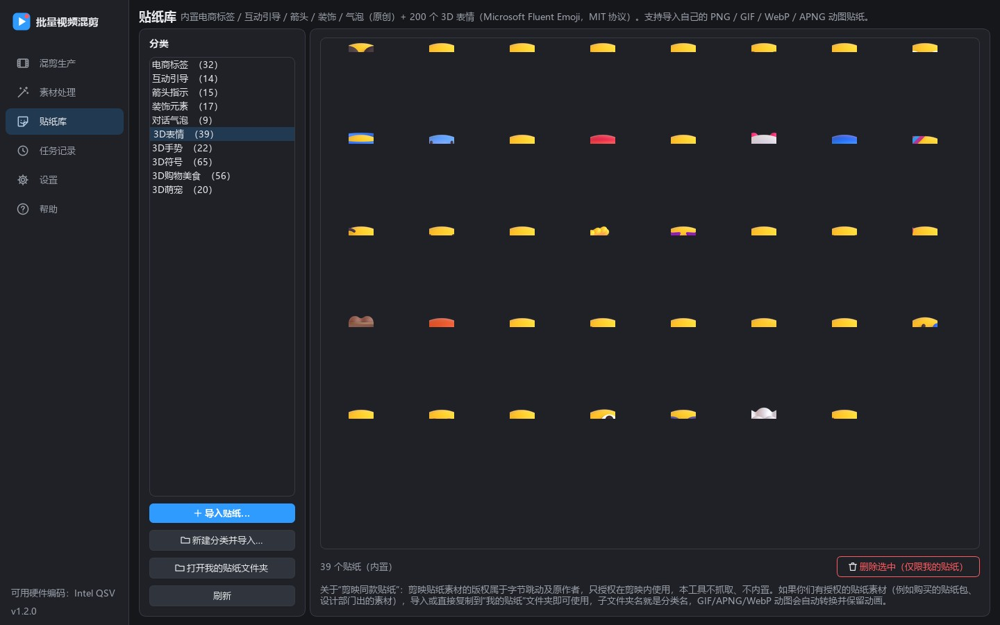

**导入自己的贴纸**：贴纸库页点“导入贴纸…”或“新建分类并导入…”，支持 PNG / JPG / WebP / GIF / APNG，**动图会自动转换并保留动画**。也可以直接把文件复制到“我的贴纸”文件夹（点“打开我的贴纸文件夹”），子文件夹名即分类名，点“刷新”生效。

> **关于“剪映同款贴纸”**：剪映贴纸素材的版权属于字节跳动及原作者，只授权在剪映内使用，本工具不抓取、不内置。内置贴纸按剪映常用分类原创设计；如果你们有已授权的贴纸素材（购买的贴纸包、设计部门制作的素材等），导入即可在混剪和素材处理中使用。

---

## 10. 任务记录与断点续跑

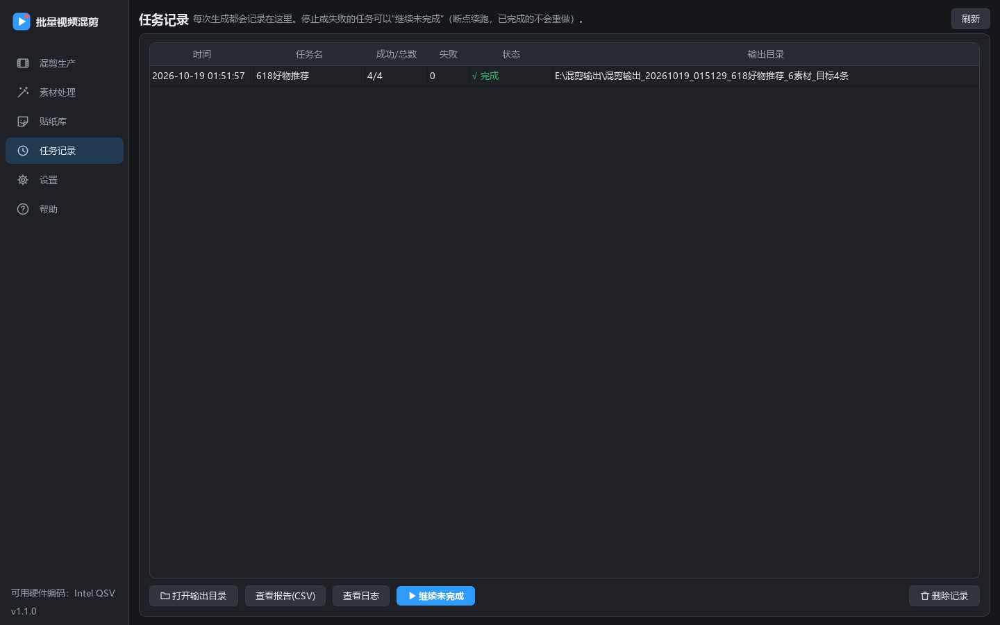

- 每次生成都会记录：时间、任务名、成功/总数、失败数、状态、输出目录。
- **继续未完成**：对“已停止”或“部分失败”的任务，按原计划继续生成缺少的成片，已完成的不会重做（即使中途断电/关机也能继续）。
- 查看报告（CSV，可用 Excel 打开）、查看日志、打开输出目录。删除记录不会删除视频文件。

---

## 11. 设置与环境自检

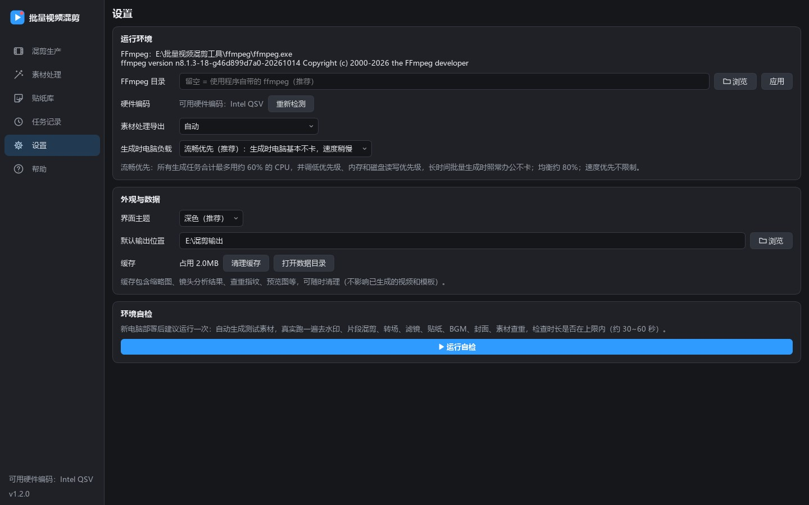

| 设置 | 说明 |
|---|---|
| FFmpeg 目录 | 留空使用程序自带（推荐）；需要时可指定其它版本 |
| 硬件编码 | 重新检测本机可用的显卡编码（实际试编码） |
| 素材处理导出 | 素材处理页导出时使用的编码方式 |
| 生成时电脑负载 | **流畅优先**（默认）：所有生成任务合计最多用约 60% 的 CPU，并调低进程、内存和磁盘读写优先级，长时间批量生成也能照常办公；**均衡**约 80%；**速度优先**不限制（最快，但电脑会比较卡） |
| 界面主题 | 深色（默认）/ 浅色 |
| 默认输出位置 | 新任务的默认输出文件夹 |
| 缓存 | 缩略图、镜头分析、查重指纹、预览图等，可一键清理 |
| 环境自检 | 新电脑部署后运行一次，确认一切正常（结果同时保存在数据目录的 `selftest.txt`） |

数据保存位置见 2.6。

---

## 12. 输出文件说明

每次任务在输出位置下新建一个文件夹，例如 `混剪输出_20261016_222805_618好物推荐_6素材_目标20条\`：

```
├─ 成片\              最终视频（MP4：H.264 + AAC，快速起播）
├─ 封面\              每条成片的封面图（JPG）
└─ 数据\
   ├─ task.json       本次任务的全部参数（可追溯）
   ├─ plan.json       每条成片用了哪些素材的哪一段（可复现、断点续跑依据）
   ├─ 素材查重.json   本次识别出的全部重复画面
   ├─ manifest.json   已完成记录
   ├─ report.csv      报告：文件名、状态、时长、片段数、使用素材、滤镜、BGM、标题、用时、失败原因
   └─ run.log         详细日志（含查重/复查结果、每条 ffmpeg 命令与耗时，便于排查）
```

处理过程中的临时文件在 `_tmp\`，任务全部成功后自动删除（可在“输出 → 保留临时文件”中保留）。

---

## 13. 性能与配置建议

| 项目 | 建议 |
|---|---|
| CPU / 内存 | 4 核 8GB 可用；8 核 16GB 及以上更流畅。并行数量保持“自动”，程序会按核数、可用内存和“生成时电脑负载”调整。 |
| 电脑卡 | 设置 →“生成时电脑负载”选**流畅优先**（默认）。想更快、生成时不用电脑，可选“均衡”或“速度优先”。 |
| 显卡 | 有 NVIDIA / AMD 独显或 Intel 核显时，“编码方式”选“自动”即可，最终合成会用显卡加速。 |
| 磁盘 | 输出放在空间充足的磁盘（每分钟成片约 60～100MB，处理过程中临时文件约为成片的 2～3 倍）。 |
| 画面尺寸 | 只需投放手机端时，720×1280 比 1080×1920 快约 2 倍、文件更小。 |
| 素材 | 素材越多、越长，片段混剪的成片差异越大。建议每批至少 5～10 个素材。 |
| 防重复 | 首次分析每分钟 1080p 素材约 2～6 秒（与电脑性能有关，多个素材并行分析），结果会缓存，同一批素材再次使用几乎不耗时；剪辑后复查每条 1 分钟成片约 2～5 秒。 |

参考速度（12 代 i5 笔记本，Intel 核显编码）：720×1280、每条约 30 秒的片段混剪，并行生成时平均约 10～20 秒/条；单条 5 分钟长成片约 2 分钟。实际速度与素材格式、分辨率、特效数量有关。

---

## 14. 常见问题

**Q1：生成的视频时长会不会超过我设的上限？**
不会。计划阶段按帧计算不超过目标时长，合成时还会再按目标时长截断兜底；剪辑后复查删除重复段只会让成片变短。

**Q2：为什么有的成片比下限还短？**
素材总时长不够、不重复的画面不够（素材里重复很多），或关闭了“素材不够时允许重复使用”；整段拼接只用放得下的完整素材，素材较长时成片也会短一些。可以增加素材，或把防重复灵敏度调为“宽松”。日志里会提示具体原因。

**Q3：成片里还是看到了重复画面？**
确认“剪辑前查重”和“剪辑后复查”都已勾选；改动很大的重复（例如重新拍摄、大幅裁切）可能需要把灵敏度调为“严格”。也可以先点“检查重复”看报告里有没有识别出来。

**Q4：口播类素材被限制得太厉害、成片偏短？**
同一主播同一背景的不同口播画面很相似，“标准”档有时会当作重复。把灵敏度调为“宽松”即可。

**Q5：速度慢 / 电脑卡？**
电脑卡：设置 →“生成时电脑负载”选“流畅优先”（默认，生成任务合计最多用约 60% 的 CPU）。速度慢：选“均衡”或“速度优先”，编码方式选“自动”启用显卡，画面尺寸选 720×1280。流畅优先下仍觉得卡（电脑较老、内存小）：输出 →“并行数量”改成 1。

**Q6：去水印后有模糊的痕迹？**
“智能填充”是用周围画面修补，框尽量贴合水印（略大一点即可）。大面积遮挡物建议用“裁剪”裁掉，或用模糊/马赛克，或盖一个贴纸。

**Q7：水印会换位置怎么办？**
分别框选每个位置，并设置各自的“生效时间段”。也可以先用“自动识别”。

**Q8：中途停电/关机了？**
重新打开程序 → 任务记录 → 选中该任务 → 继续未完成。

**Q9：某条显示失败？**
程序已自动重试一次。把鼠标停在失败行上可看原因；常见原因：素材文件损坏、磁盘空间不足、文件被其它程序占用。详细信息见该任务 `数据\run.log`。

**Q10：显卡加速没生效？**
设置 → 硬件编码 → 重新检测。显卡驱动过旧时检测会失败，程序会自动使用 CPU。更新显卡驱动后再检测。

**Q11：成片之间太相似？**
用片段混剪模式、增加素材、开启“避免成片雷同”、每条随机滤镜、转场、随机变速、背景音乐随机起点。

**Q12：免安装版第一次打开很慢？**
第一次需要把程序文件解压到系统目录（10～30 秒），之后就很快。如果被杀毒软件拦截，请加入信任或改用安装版。

**Q13：预览播放窗口怎么操作？**
空格暂停/继续，左右方向键快退/快进，Esc 关闭。

**Q14：能在没有网络的内网电脑使用吗？**
可以，程序完全离线运行。

**Q15：声音和画面、字幕对不上？**
v1.2 已修复：素材里声音比画面晚开始、声音中途断档，都会自动补齐对齐。如果素材本身播放时就对不上，需要先在剪辑软件里调整好再导入。

**Q16：整段拼接时素材开头、结尾被剪掉了？**
v1.2 起不会：每个素材从第一帧到最后一帧完整保留，转场用定格过渡、不占用素材画面。只有设置了“掐头去尾”、勾选了“放不下时截掉素材结尾”，或素材本身比时长上限还长时才会截取（保留开头）。

---

## 15. 使用规范

本工具用于对**自有或已获授权**的素材进行批量整合、规格统一、模板化剪辑和多版本生产，以提升团队效率。

1. 请只处理你有权使用的素材，尊重著作权与各平台规则。
2. 去水印/去贴纸功能用于清理自有素材上的旧水印、误加贴纸或遮挡物，**请勿用于去除他人作品的署名水印或搬运他人作品**。
3. “画面变体 / 元数据”是多版本测试与归档能力，本工具**不承诺、也不应被用于“过审 / 去重 / 伪原创”**。现代平台使用内容指纹识别，此类做法无效且有封号风险。“防重复”功能只保证你自己的成片内部不出现重复画面，不涉及平台查重。
4. 背景音乐、字体、贴纸请使用有版权或可商用的资源（内置资源均可商用，见附录 C）。
5. 每个任务的输出目录都保留了参数、计划、查重结果、日志和报告，便于企业内部审计。

---

## 附录 A：技术实现要点

| 方面 | 实现 |
|---|---|
| 时长控制 | **“时长上限”模式**：不超过 X 分钟 + 随机浮动，按帧规划、片段混剪最后一段自然截短；整段拼接只挑放得下的完整素材（不截断）；合成时再按目标时长兜底 |
| 音画同步 | 每段渲染时画面和声音共用同一个时间零点（不各自归零），声音晚开始时补静音、画面晚开始时补第一帧，声音中途断档超过 0.1 秒自动补静音；各段音频按帧精确对齐，拼接后不累积误差 |
| 整段拼接转场 | **定格过渡**：前一段最后一帧与后一段第一帧做过渡，相邻素材不重叠，素材画面一帧不少 |
| 渲染流水线 | “**片段渲染 → 衔接片 → 顺序合成**”两阶段：单条 filter_complex 处理 30 段时内存峰值约 4.6GB，两阶段方案峰值约 **0.7GB**；片段可并行、可缓存，共用片头只渲染一次 |
| 成片差异 | **素材覆盖均衡 + 成片相似度指纹**控制；v1.1 加入**画面级防重复**（剪辑前查重 + 剪辑后复查） |
| 画面查重 | pHash + 镜像指纹 + 逐帧自动去黑边/模糊背景 + 连续帧判定；复查候选换算回素材原始画面再确认 |
| 并发与缓存 | 缓存键、任务清单加锁、秒级时间戳、并发数按 CPU 与可用内存自适应；片段级并行池（单条长成片也能吃满 CPU） |
| 显卡编码 | **实际试编码**才启用 NVENC / QSV / AMF，运行中出错自动回退 CPU |
| 编码次数 | 滤镜、调节、变体、贴纸、文字、角标在**最终合成时一次编码**完成，减少画质损失 |
| 片段混剪 | 镜头切点检测（与查重同一遍解码、结果缓存）、片段优先对齐镜头切点、随机变速 |
| 音频 | 响度统一（EBU R128）、BGM 混音（随机起点 / 循环 / 淡入）、结尾淡出、片段接缝防爆音 |
| 转场与动画 | 23 种叠化转场 + 5 种切换特效（概率可调）；7 种入场 + 7 种循环动画 + 渐隐，角标四角随机且自动避让 |
| 抽帧利用 | **自动挑选封面**（清晰度 / 亮度 / 色彩评分）、成片复查 |
| 产品化 | 方案保存/载入、命名模板、CSV 报告、任务记录、一键续跑、缩略图、拖拽导入 |
| 分发 | **安装包**（免管理员、桌面/开始菜单快捷方式、可卸载）+ **单文件免安装版**；随包 FFmpeg、版本信息、图标；Python 3.12 |
| 素材处理 | 去水印/去贴纸/去遮挡（智能填充、模糊、马赛克、色块、画笔、**自动识别**、分时段、裁边、自动检测黑边） |
| 滤镜与调节 | 33 款滤镜（含强度）+ 10 项调节，所见即所得缩略图 |
| 贴纸库与花字 | 289 款贴纸、自定义动图贴纸导入、16 种花字、5 款可商用字体 |
| 兼容性 | HDR 自动转换、手机旋转视频、可变帧率、奇数分辨率、损坏文件自动跳过、中文/特殊字符路径 |
| 稳定性 | 无进度看门狗（防卡死）、子进程随主程序退出自动结束、失败自动重试、防休眠、环境自检 |
| 电脑负载 | 三档：Windows 作业对象给全部 ffmpeg 进程设 CPU 总量硬上限（60% / 80% / 不限），并调低进程、内存、磁盘读写优先级，线程数按可用 CPU 分配；中间片段用更快的编码预设（CPU 省一半） |

---

## 附录 B：快捷键

| 位置 | 快捷键 | 功能 |
|---|---|---|
| 素材处理 | V / R / B / E | 选择 / 框选区域 / 画笔 / 橡皮 |
| 素材处理 | ← / → | 时间轴后退 / 前进 1 秒 |
| 画布 | Delete | 删除选中的区域或贴纸/文字 |
| 画布 | Ctrl + 滚轮 / 鼠标中键拖动 | 缩放 / 平移画面（“适应”恢复） |
| 素材列表 | Delete | 移除选中素材 |
| 预览播放器 | 空格 / ← → / Esc | 暂停 / 快退快进 / 关闭 |

---

## 附录 C：第三方组件授权

| 组件 | 协议 | 说明 |
|---|---|---|
| FFmpeg 8.1 | GPL v3 | 以独立程序方式放在程序目录的 `ffmpeg\` 文件夹，协议见 `ffmpeg\LICENSE.txt` |
| Qt 6 / PySide6 | LGPL v3 | 动态库形式随附 |
| Python 3.12、NumPy、Pillow | PSF / BSD / HPND | — |
| Microsoft Fluent Emoji | MIT | 3D 表情贴纸 |
| 思源黑体、得意黑、站酷快乐体、站酷庆科黄油体、马善政毛笔楷书 | SIL OFL 1.1 | 可免费商用 |
| Inno Setup | Inno Setup License | 用于制作安装包 |
| 电商标签/互动引导/箭头/装饰/气泡贴纸、滤镜参数、花字预设 | 本工具原创 | — |

---

## 附录 D：版本更新记录

**v1.2.0（2026 年 10 月）**

- 修复音画不同步：素材里声音比画面晚开始、声音中途断档时，以前声音会整体提前（实测 0.35～0.88 秒），现在严格对齐。
- 混剪模式默认改为**整段拼接**：素材从第一帧到最后一帧完整保留、不拆分，随机顺序拼接；超出时长上限时只挑放得下的完整素材，不再截掉素材结尾；以前每个素材结尾还会被多截约 0.1 秒，现已修复。
- 整段拼接的转场改为定格过渡，不占用素材首尾画面；查重时有重复的素材整段跳过 / 整段移除，不从中间拆开。
- 新增“生成时电脑负载”三档，默认“流畅优先”：生成任务合计最多用约 60% 的 CPU，并调低优先级，长时间生成电脑不卡；中间片段编码快一倍。

**v1.1.0（2026 年 10 月）**

- 新增“防重复”：剪辑前素材查重（识别素材之间/素材内部重复画面、重复导入、镜像/滤镜/改画幅后的同一画面），同一条成片不重复使用；剪辑后抽帧复查，发现重复片段自动剪掉（最多 3 轮）。
- 新增素材列表“重复”列、“检查重复”按钮与查重报告，可一键移除完全重复的素材。
- 新增安装包（免管理员权限、桌面/开始菜单快捷方式、可卸载）与单文件免安装版，不再需要“程序 + 附带文件夹”。
- 数据统一保存到 `%APPDATA%\BatchVideoMixer`，升级不丢设置。
- 环境自检增加素材查重项目。

**v1.0.0（2026 年 10 月）**

- 首个版本：片段混剪/整段拼接、时长上限控制、素材处理（去水印/去贴纸/去遮挡、滤镜、调节、贴纸、文字）、包装设计器、贴纸库、任务记录与断点续跑、显卡加速、环境自检。

*批量视频混剪工具 v1.2.0 · 使用文档*
